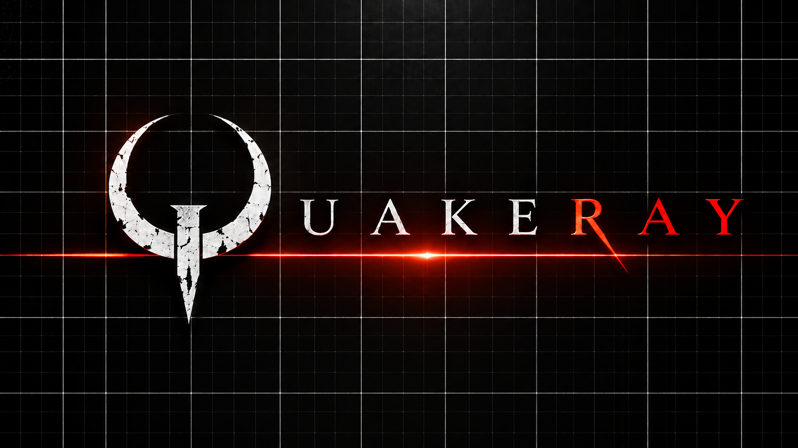

# QuakeRay engine

QuakeRay is a ray tracing engine for Quake 1. Its lighting is based on Q2RTX, with improvements to materials, light sources, skies and visual effects. It runs on Vulkan using NVIDIA NVRHI, with a multithreaded render frame built on the engine's own task graph.

[Download](https://github.com/f1ames0ff/QuakeRay/releases) · [What's new](changelog.md) · [Report a problem](https://github.com/f1ames0ff/QuakeRay/issues)

Code navigation for agents and contributors: [Architecture index](ARCHITECTURE.md) · [Performance evidence](PERFORMANCE.md) · [Multithreading](docs/multithreading.md).

Agents must use the **QuakeRay engine MCP** as their primary inspection/evidence interface and follow
the [mandatory workflow](AGENTS.md#mandatory-engine-mcp-workflow), including explicit reporting of
unavailable tools or coverage gaps.

## Features

### Core features

- **Q2RTX-inspired ray-tracing**
- **Multithreading**
- **DTAL System (Dynamic Texture Area Lights)**
- **Lighting and Material Editor**

#### Game data and compatibility

- **Quake Remastered support**
- **Automatic Steam game detection**

### Lighting and editing

- **PBR materials**
- **Water, glass and other RT-specific materials**

### Graphics

- **Volumetric clouds**
- **Sun shafts and traced fog volumes**
- **Enhanced models**
- **Exposure and tone-mapping controls**
- **Shader smoke**
- **FSR 3.1 upscaling**

### Sound

- **OpenAL Soft sound backend with HRTF binaural sound and five-band equalizer**

### Interface and performance monitoring

- **Performance statistics and benchmarks**
- **Custom Quake cursor**

QuakeRay is still in development. Some maps and mods may have visual or compatibility issues.

## Roadmap

- FSR 4
- DLSS
- Full path tracing and further lighting improvements
- More visual effects
- Improved Arcane Dimensions support
- Production-ready whole-frame CPU multithreading: the render task frame is the only path since the
  serial fork was retired (2026-10-14). Continue by extending task coverage beyond render producers,
  reducing measured serial/lock bottlenecks, hardening scheduling and completing the
  correctness/scalability matrix.
  See the
  [multithreading milestones and acceptance gates](docs/multithreading.md#roadmap-to-production-ready-whole-frame-multithreading).

These are goals, not promises of a release date.

The separate performance goal is at least **45 FPS at 4K FSR Quality** on the reference hardware
throughout the maintained gameplay scene matrix, with frame-time improvement as internal resolution
is reduced. Both CPU and GPU budgets must be met; multithreading alone cannot guarantee that target.

## Requirements

You need:

- **64-bit Windows.** Linux and macOS are not currently supported.
- **A graphics card with hardware ray tracing and Vulkan support**, with an up-to-date driver.
- **Quake game files.** QuakeRay does not include the original game. You can use your own Quake installation or the shareware version.

## Installation

1. Download a Windows archive from [Releases](https://github.com/f1ames0ff/QuakeRay/releases), when available.
2. Extract it. The archive contains one `QuakeRay-v<version>-win64` folder; keep the DLL files and the `id1` folder beside `quakeray.exe`.
3. Run `quakeray.exe`.

**Updating:** the archive also carries a standard `id1/config.cfg`. Extracting a new release over an existing install and overwriting files replaces your `id1/config.cfg` and `id1/qray.materials.yaml`; back up your settings and editor changes first.

### Where to put Quake

If Quake is installed through Steam, QuakeRay can find its game files automatically. When both Steam versions are installed and the game folder has no local Quake data, it offers a choice of **Original** or **Remastered**; local data takes priority and skips the choice.

For a manual installation, copy the game files from your Quake installation into `id1` beside `quakeray.exe`. The full original game uses `pak0.pak` and `pak1.pak`; shareware uses `pak0.pak` only. GOG and Epic installs are not detected automatically: copy the files into `id1` or point `-basedir` at the install.

**Keep `id1/qray.pkz` and `id1/qray.materials.yaml`.** They belong to QuakeRay and are needed for its graphics. The release archive already includes them and a standard `id1/config.cfg`.

### Mods and mission packs

Place each mod in its own folder beside `id1`, then choose it from the **Mods** menu. Mods in a detected Steam installation can also appear there. Local files take priority over Steam files.

Mods and mission packs require the full registered game; the shareware version cannot run them. The original mission packs are the `hipnotic` and `rogue` folders.

Original and Remastered game files are handled separately. Use the version a mod was made for, and expect some mods to need further compatibility work. Steam mods follow the chosen version: classic Steam mods appear in Original, while `rerelease` add-ons and Nightdive downloads appear in Remastered.

## How to send bug reports

### 1. Collect a log

Launch the game with `-condebug`:

```text
quakeray.exe -condebug
```

You can also add `-condebug` to a Windows shortcut's target. Reproduce the problem and close the game. Keep **`qconsole.log`** and **`crash.log`** from the folder you started the game in — usually beside `quakeray.exe`; a shortcut's **Start in** folder decides it. `qconsole.log` is replaced on each run, and a later crash overwrites `crash.log`. Copy both before launching again.

In the release build, `crash.log` is written only when the game stops on an unhandled exception; a normal Quake error dialog does not create one.

### 2. Record performance

Open the console with the **`~` / backtick** key and enter:

```text
rt_stats 3
rt_stats_dump_start
```

Close the console and play through the slowdown or problem area. Open the console again and enter `rt_stats_dump_end` to finish. Recording also stops automatically **30 seconds** after it starts, so start it just before the area. The recording is kept in memory until it ends: closing the game before `rt_stats_dump_end` or the 30-second timeout loses it.

Keep the resulting **`stats-YYYYMMDD-HHMMSS.dump`** file from the active game folder (`id1`, or the mod folder you are playing).

For a problem tied to a map, also run **`rt_stats_dump`**: it appends one frame, including the map's cluster/light report, to **`qperfdump.log`** in the same folder.

### 3. Send your report

[Open an issue](https://github.com/f1ames0ff/QuakeRay/issues) and attach the **log and performance dump**, plus `crash.log` and `qperfdump.log` if available. Include:

- What happened and how to reproduce it.
- Your graphics settings: resolution, upscaler/FSR quality and ray-tracing quality (the log already records your GPU, driver, resolution and refresh rate).
- The map or mod you were playing.
- A screenshot, if it is a visual problem.

## Build from source

This section is for contributors. Players can skip it.

Install [Git](https://git-scm.com/download/win), [Visual Studio Build Tools](https://visualstudio.microsoft.com/downloads/) with **Desktop development with C++**, [CMake](https://cmake.org/download/) 3.20 or newer, [Ninja](https://ninja-build.org/), [Python 3](https://www.python.org/downloads/windows/) on `PATH` and a recent [Vulkan SDK](https://vulkan.lunarg.com/sdk/home) with `dxc` and Vulkan C++ headers. Vulkan SDK 1.4.321.1 is used for local builds.

In PowerShell:

```powershell
git clone --recursive https://github.com/f1ames0ff/QuakeRay.git
cd QuakeRay
.\build_win.ps1 Debug
.\build\Debug\quakeray.exe
```

For an existing checkout, run `git submodule update --init --recursive` before building. If the compiler runs out of memory, try `.\build_win.ps1 Debug -Parallel 4`. Run `ctest --test-dir build\Debug` for the regular regression tests; build with `.\build_win.ps1 Debug -Tests` to add the renderer's GPU regression tests. Close any running QuakeRay instance first: `build_win.ps1` stops with `MACHINE_BUSY` while the game or another build is running.

Use **`build_win.ps1`**, not just a plain CMake build: it compiles the shaders, prepares the game assets and applies the pinned NVRHI patch (`third_party/nvrhi-max-binding-layouts.patch`); an IDE or manual CMake build has to apply that patch itself. Quake game files are still required, just as for a packaged release.

## Credits and license

Created and maintained by **f1ames0ff**, building on Quake, QuakeSpasm and vkQuake, with the renderer derived from NVIDIA's Quake 2 RTX, and the work of many contributors. See [AUTHORS.md](AUTHORS.md) for credits and [changelog.md](changelog.md) for release notes.

QuakeRay's engine and renderer are distributed under the **GNU GPL, version 2 or later**. See [LICENSE.txt](LICENSE.txt) and the notices in the release archive for third-party licenses. Original Quake game content is not included.

## Built with

These technologies help power QuakeRay. You do not need to install them separately to play.

<table>
  <tr>
    <td align="center"><a href="https://gpuopen.com/fidelityfx/"></a></td>
    <td align="center"><a href="https://www.vulkan.org/"></a></td>
    <td align="center"><a href="https://github.com/NVIDIA-RTX/NVRHI"></a></td>
  </tr>
  <tr>
    <td align="center"><a href="https://gpuopen.com/fidelityfx/">AMD FidelityFX SDK</a><br>FSR 3.1 upscaling</td>
    <td align="center"><a href="https://www.vulkan.org/">Vulkan</a><br>Graphics and ray tracing</td>
    <td align="center"><a href="https://github.com/NVIDIA-RTX/NVRHI">NVIDIA NVRHI</a><br>The renderer's graphics API layer: command lists, bindings and resources</td>
  </tr>
</table>

Also using [OpenAL Soft](https://openal-soft.org/) for sound and [Dear ImGui](https://github.com/ocornut/imgui) for editors and performance displays.

Logos identify the technologies used, not sponsorship or endorsement. Vulkan and the Vulkan logo are registered trademarks of the Khronos Group Inc. AMD, NVIDIA and their logos belong to their respective owners.
