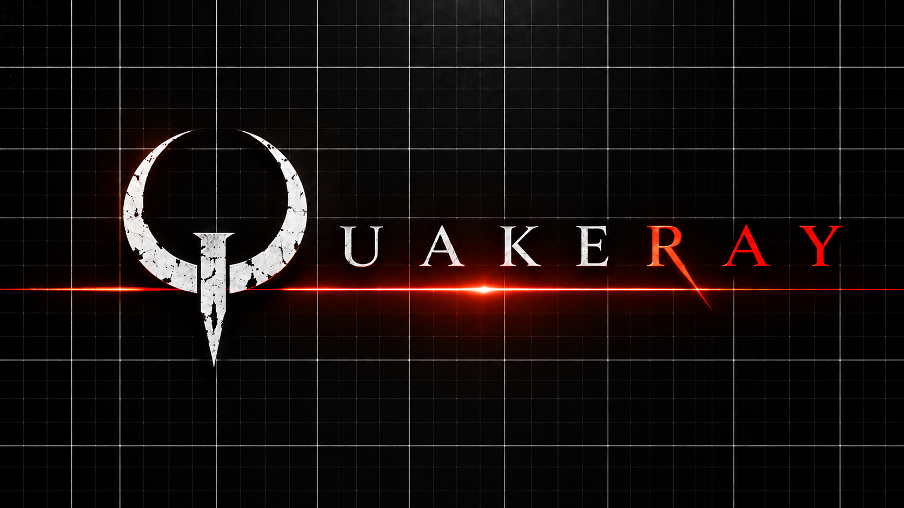

# QuakeRay

**QuakeRay** brings **full real-time path tracing** to the classic 1996 *Quake* on **Windows and Linux** — keeping every rocket jump, secret wall, mod, and feel of the original game intact while replacing baked 1990s lighting with physically simulated light, shadows, atmosphere, water, and reflections powered by Vulkan hardware ray tracing and [`QuakeRaySDK`](https://github.com/f1ames0ff/QuakeRaySDK).

[Download](https://github.com/f1ames0ff/QuakeRay/releases) · [What's new in v0.60.0](changelog.md) · [Report a problem](https://github.com/f1ames0ff/QuakeRay/issues)

---

## Features

QuakeRay is designed so you do not need to know anything about graphics programming to see the difference the moment you step through the Start map:

### 1. Real-Time Path Tracing & Global Illumination
Instead of faking brightness with pre-baked lightmaps, QuakeRay traces real rays of light across the entire level every frame. Light bounces naturally off stone walls, brass trim, and blood-red corridors (**global illumination**), lava pits and glowing runes genuinely illuminate the rooms around them, and **Dynamic Texture Area Lights (DTAL)** turn glowing panels and stained glass into soft, physical area lights with natural penumbras instead of harsh game-y circles.

### 2. Volumetric Light Shafts & Atmospheric Fog
Sunlight, moonlight, spotlights, overhead skylights, and flickering torches cut through dusty catacombs and cavernous arenas as tangible beams of light. QuakeRay simulates shadowed **3D volumetric fog** and supports up to **64 simultaneous light-shaft sources** alongside drifting **godrays** beneath the open sky — automatically casting shadows from geometry and overhead clouds alike.

### 3. True Reflections, Refractive Water, Glass & Subsurface Scattering
Pools of water, slime, polished armor, metal floors, and true mirrors reflect the real 3D world around them — including flames, explosions, and monsters behind your back, not just what happens to fit on screen. Looking into deep water or through glass bends light realistically with distance absorption, while **real-time Subsurface Scattering (SSS)** lets light soak softly into organic surfaces, wax, skin, and creatures.

### 4. Modern AAA-Grade Denoising & AMD FSR 3.1 Upscaling
Path tracing shoots millions of light rays every second, and turning raw rays into a rock-solid image at playable framerates takes heavy reconstruction work — the same family of modern spatio-temporal techniques used in flagship engines like Unreal Engine. QuakeRay pairs an overhauled specular **reflection denoiser** with a 4-stage emissive **A-SVGF spatio-temporal denoiser** that cleans up shimmering "fireflies" and stabilizes glowing surfaces in motion.

To push resolution and framerates even further, QuakeRay builds **AMD FidelityFX Super Resolution 3.1 (FSR 3.1)** directly into the Vulkan pipeline on both Windows and Linux, letting you play crisp 1440p or 4K path tracing on mid-range ray-tracing GPUs.

### 5. Dynamic 24-Hour Procedural Sky, 3D Clouds & Night Starfield
Step outdoors and look up: QuakeRay renders a physically modeled **24-hour spherical atmosphere** (Rayleigh, Mie, and ozone scattering) that transitions seamlessly from warm golden-peach sunrises and deep blue noon skies to directional sunsets and calm nights. You get:
- Drifting **3D volumetric clouds** that shade themselves and dynamically eclipse the sun and its light shafts.
- A razor-sharp **2048×2048 HDR skybox** with an anti-aliased **starfield** and a phased **moon** that casts balanced nocturnal moonlight.
- Custom RGB atmosphere tints so surreal and alien Quake dimensions keep their unmistakable otherworldly mood.

### 6. Mods, Official Mission Packs & Quake Remastered Support
QuakeRay builds on QuakeSpasm and vkQuake compatibility while automatically discovering your installed Steam copy of *Quake* (**Original** or **2021 Remastered** — letting you pick if both are installed):
- Full support for official expansions: *Scourge of Armagon* (`hipnotic`), *Dissolution of Eternity* (`rogue`), *Dimension of the Past*, and *Dimension of the Machine*.
- Specially optimized for massive community overhauls like **Arcane Dimensions** (handling huge levels with 1,500+ active lights, dynamic geometry, and dense particle battles smoothly).
- Drop-in **Mods** menu supporting classic mod folders as well as Remastered add-ons.

### 7. Live In-Game & Standalone Visual Editors (`quakerayeditor`)
Want to restyle an episode, paint glowing moss, tweak water roughness, or relight a favorite arena? You can do it live without ever opening Hammer/TrenchBroom or recompiling a `.bsp` map:
- Paint **PBR materials** (roughness, metalness, emission, glass, water, mirror, light projectors) and **feathered SSS masks** with a live circular brush directly on surfaces.
- Place, move, aim, and **marquee multi-select** custom point/spot lights with 3D gizmos, batch-edit groups of lights, and preview the **24-hour sky ephemeris**.
- Available both **inside the game** and as the **standalone `quakerayeditor`** app on Windows and Linux.

### 8. Cinematography, Crisp Pixel-Art or Filtered Textures & 3D Audio
- **Film-grade HDR color**: Choose between **AgX**, **ACES**, **Reinhard**, and **Q2RTX** tone-mapping profiles, physical bloom, subtle near depth-of-field, shader smoke, and automatic exposure.
- **Classic or ultra-sharp textures**: Pick classic crisp **Nearest** pixel art all the way up to **16x Anisotropic** texture filtering right in Video Options.
- **3D Binaural Sound**: Powered by **OpenAL Soft** with headphone **HRTF spatial audio** and a 5-band equalizer so you can pinpoint ogre grenades behind walls by ear.
- **Built-in performance HUD & benchmarks**: Frame-time breakdown, GPU/CPU telemetry, and custom Quake cursor support.

> **Note:** QuakeRay is actively evolving. While core campaigns, mission packs, and major mods like Arcane Dimensions are well tested, some experimental custom mods or exotic map tricks may still show visual quirks.

---

## Requirements

- **OS:** **64-bit Windows (10/11)** or **64-bit Linux**. *(macOS is not supported because Apple platforms lack Vulkan hardware ray tracing extensions.)*
- **GPU:** Any graphics card with **Vulkan hardware ray tracing** (`VK_KHR_ray_query` and `VK_KHR_acceleration_structure`) and up-to-date drivers — NVIDIA GeForce RTX 2060+, AMD Radeon RX 6000 / 7000 / 9000+, or Intel Arc A/B-series.
- **Quake Game Files:** QuakeRay is an open-source engine and does not ship copyrighted level data. You need either a Steam/GOG install of **Quake** / **Quake Remastered** (`pak0.pak` and `pak1.pak`) or the free Shareware episode (`pak0.pak`).

---

## Installation & Quick Start

1. Download the latest archive for your platform from [Releases](https://github.com/f1ames0ff/QuakeRay/releases) (when available), or build from source below.
2. Extract the archive into its own folder. Keep the shipped shared libraries (`.dll` / `.so`) and the `id1/` folder next to the `quakeray` executable.
   > **Updating an existing install:** Back up `id1/config.cfg` and any custom edits in `id1/qray.materials.yaml` before extracting a new version over an old folder.
3. Run **`quakeray.exe`** (Windows) or **`./quakeray`** (Linux).
4. **First launch tip:** Open **Options → Video Options** to pick your preferred **FSR 3.1** preset (Quality / Balanced / Performance) and texture filtering mode (`Nearest` through `16x Anisotropic`).

### Where to Put Quake Game Files
- **Steam (Automatic):** If *Quake* is installed via Steam and no local `pak0.pak` exists in `id1/`, QuakeRay locates your Steam library automatically. If both **Original** and **Remastered** are installed, QuakeRay lets you choose which edition to launch.
- **GOG / Epic / Retail Copy:** Copy `pak0.pak` and `pak1.pak` into the `id1/` folder next to `quakeray`, or launch with `-basedir /path/to/your/quake`.
- **Keep QuakeRay's asset files:** Always keep **`id1/qray.pkz`** and **`id1/qray.materials.yaml`** intact — they ship QuakeRay's PBR textures, sky/shader assets, and default material rules.

### Playing Mods & Mission Packs
- Place each mod folder (for example `ad` for *Arcane Dimensions*, `hipnotic` for *Scourge of Armagon*, or `rogue` for *Dissolution of Eternity*) next to `id1/`, then open the in-game **Mods** menu — or pass `-game ad` / `-hipnotic` / `-rogue` on the command line.
- Mods discovered inside a Steam installation also appear automatically in the **Mods** menu (local folders take priority). Mods and mission packs require the full registered `pak0.pak` + `pak1.pak` files.

---

## Roadmap

Planned milestones currently in active design and development:
- **Next-Gen id Tech 8-Inspired Lighting Pipeline**: GPU world-space light grid, **ReSTIR** direct lighting, and a **World-Space Radiance Cache** for extreme light counts in mega-maps and mods.
- **FSR 4 & NVIDIA DLSS**: Expanding AI-accelerated upscaling and frame reconstruction options alongside FSR 3.1.
- **Whole-Frame CPU Multithreading**: Expanding the engine's lock-light **task-graph render frame** further across gameplay and world extraction to keep high-refresh CPUs fed ([roadmap & milestones](docs/multithreading.md#roadmap-to-production-ready-whole-frame-multithreading)).
- **Expanded PBR & Mod Coverage**: Richer out-of-the-box material/SSS packs for official expansions and popular community mods.

*(Target benchmark bar: **45+ FPS at 4K FSR Quality** on reference hardware across maintained gameplay scenes. Roadmap items are engineering goals, not release-date promises.)*

---

## How to Send Bug Reports

If you hit a crash, visual artifact, or severe slowdown:

1. **Collect logs** by launching with `-condebug`:
   ```text
   quakeray -condebug
   ```
   Reproduce the issue, close the game, and grab **`qconsole.log`** (and **`crash.log`** on Windows if generated on an unhandled exception) from the working directory you launched from.
2. **Record a performance trace** (if reporting low FPS or stutters): open the console with **`~` / backtick** right before entering the slow area and run:
   ```text
   rt_stats 3
   rt_stats_dump_start
   ```
   Play for a few seconds and run `rt_stats_dump_end` (recording stops automatically after 30 seconds if you forget). Also run **`rt_stats_dump`** to append a single-frame cluster/light snapshot to **`qperfdump.log`**. Attach the generated **`stats-YYYYMMDD-HHMMSS.dump`** file from `id1/` (or your active mod folder).
3. **[Open an issue](https://github.com/f1ames0ff/QuakeRay/issues)** with your logs, map/mod name, GPU + driver version, display/FSR settings, and a screenshot if the problem is visual.

---

## Build from Source & Contributing

This section is for developers and contributors; players can skip it.

### Windows (PowerShell)
Install [Git](https://git-scm.com/download/win), Visual Studio Build Tools (**Desktop development with C++**), [CMake](https://cmake.org/download/) 3.20+, [Ninja](https://ninja-build.org/), [Python 3](https://www.python.org/downloads/windows/), and a recent [Vulkan SDK](https://vulkan.lunarg.com/sdk/home) (with `dxc` and Vulkan C++ headers).

```powershell
git clone --recursive https://github.com/f1ames0ff/QuakeRay.git
cd QuakeRay
.\build_win.ps1 Debug
.\build\Debug\quakeray.exe
```

- Always use `.\build_win.ps1 Debug` (not raw `cmake --build`): it sets up the MSVC environment, builds shaders, deploys runtime assets, and applies the pinned NVRHI patch cleanly. Close any running QuakeRay instance first (`build_win.ps1` stops on `MACHINE_BUSY`).
- Optional standalone editor: `.\build_editor.ps1` → `.\build\editor\editor\quakerayeditor.exe`.

### Linux
With GCC/Clang, CMake 3.20+, Ninja, Python 3, SDL2, OpenAL Soft, Vulkan SDK (`dxc`), and standard X11/Wayland development headers installed:

```bash
git clone --recursive https://github.com/f1ames0ff/QuakeRay.git
cd QuakeRay
./build_linux.sh
./build/linux-debug/quakeray
```

`./build_linux.sh` configures the engine, builds FidelityFX FSR 3.1 from source, compiles HLSL shaders to SPIR-V, packs `id1/qray.pkz`, and stages assets into `build/linux-debug/` (pass `QR_RUN_TESTS=1` to run the CPU test suite via CTest automatically). On Linux, the standalone `quakerayeditor` binary can be built standalone from the `renderer/` (`QuakeRaySDK`) CMake tree (`cmake -S renderer -B renderer/build`).

### Architecture & Agent Documentation
- [Architecture Index (`ARCHITECTURE.md`)](ARCHITECTURE.md) · [Performance Evidence (`PERFORMANCE.md`)](PERFORMANCE.md) · [Task-Graph Multithreading (`docs/multithreading.md`)](docs/multithreading.md)
- Contributors and automated agents working in this repository must follow [`AGENTS.md`](AGENTS.md#mandatory-engine-mcp-workflow), including using the **QuakeRay engine MCP** as the primary engine-inspection interface.

---

## Credits & License

Created and maintained by **f1ames0ff**, building on id Software's *Quake*, **QuakeSpasm**, and **vkQuake**, with the path-tracing renderer (`QuakeRaySDK`) derived from NVIDIA's **Quake 2 RTX** and extended with contributions from the community. See [AUTHORS.md](AUTHORS.md) and [changelog.md](changelog.md) for details.

QuakeRay and `QuakeRaySDK` are licensed under the **GNU General Public License, version 2 or later (GPLv2+)** — see [LICENSE.txt](LICENSE.txt). Original *Quake* game assets are copyright id Software / ZeniMax and are not included.

## Built With

These technologies help power QuakeRay. You do not need to install them separately to play.

<table>
  <tr>
    <td align="center"><a href="https://gpuopen.com/fidelityfx/"></a></td>
    <td align="center"><a href="https://www.vulkan.org/"></a></td>
    <td align="center"><a href="https://github.com/NVIDIA-RTX/NVRHI"></a></td>
  </tr>
  <tr>
    <td align="center"><a href="https://gpuopen.com/fidelityfx/">AMD FidelityFX SDK</a><br>FSR 3.1 upscaling (built from source)</td>
    <td align="center"><a href="https://www.vulkan.org/">Vulkan</a><br>Cross-platform graphics &amp; hardware ray tracing</td>
    <td align="center"><a href="https://github.com/NVIDIA-RTX/NVRHI">NVIDIA NVRHI</a><br>Renderer RHI command lists, bindings &amp; resources</td>
  </tr>
</table>

Also powered by [OpenAL Soft](https://openal-soft.org/) (3D HRTF audio) and [Dear ImGui](https://github.com/ocornut/imgui) (live visual editors and performance HUD).

Logos identify the technologies used, not sponsorship or endorsement. Vulkan and the Vulkan logo are registered trademarks of the Khronos Group Inc. AMD, NVIDIA and their logos belong to their respective owners.
